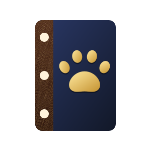
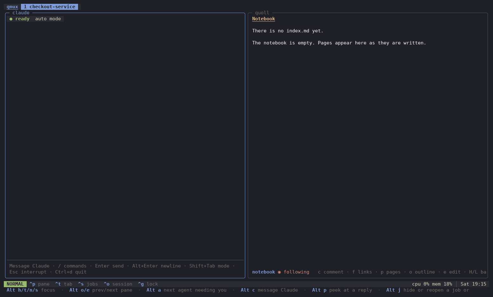

<p align="center"></p>

<h1 align="center">quoll</h1>

A terminal viewer for a story's design notebook: a folder of markdown pages and images, readable in Obsidian too.



*Native Claude in komux on the left, quoll on the right. Claude writes a plan with a backoff table, and quoll follows each page as it is saved. `c` on the table opens Claude's message box with the table attached, a comment asks for a lower cap, and Claude revises the table in place. Waiting on the model is time-lapsed.*

```
quoll [dir] [--focus[=name]] [--pick] [--no-follow]  view the notebook
quoll show <page>[#heading]                 make the open viewers show a page
quoll path                                  print the notebook folder
quoll watch                                 print "changed: <page>" each time a page is saved
quoll tags [tag]                            list the frontmatter tags and their pages, or the pages with one tag
```

Set `QUOLL_DIR` to the notebook root, which holds a folder per notebook. `quoll` browses them all; `quoll --focus=sc-123` opens `$QUOLL_DIR/sc-123`, creating it when it's missing; and a bare `--focus` names the notebook after the current directory, so from `~/work/stories/sc-123` it opens `$QUOLL_DIR/sc-123`. `--dir` overrides `QUOLL_DIR` for one run. Without it, the notebook root is the current directory, and `--focus` needs a name. A folder named on the command line is opened as it is.

`QUOLL_DIR` can list several roots separated by colons, such as one for work notes and one for personal ones. The first time the viewer opens from a directory, it asks which root to use and remembers the answer for that directory in `$XDG_STATE_HOME/quoll/roots.json`; `--pick` asks again. `quoll path`, `show`, `watch` and `tags` use the remembered root, and fail with the list of roots when there isn't one yet.

Inside komux, `quoll show`, `quoll path`, `quoll watch` and `quoll tags` use the notebook the quoll in the same tab is showing, so they work from anywhere in the tab.

Keys: `j`/`k`, `d`/`u`, `g`/`G` scroll · `f` links · `p` pages · `t` tags · `o` outline · `i` index · `H`/`L` back and forward · `e` edit in helix · `w` follow · `r` reload · `c` comment · `q` quit.

`c` comments on a block of the page: pick one by its hint letter, by moving with `j`/`k` and pressing Enter, or by clicking it. quoll runs `QUOLL_COMMENT_COMMAND` with a short label for the block as its last argument, joined with `=` when the command ends in an option such as `--label`, and sends the block's file, line numbers, heading path and source on stdin. Inside komux, `komux claude compose --from-stdin --label` opens the message box for the tab's Claude with that context attached. Without the variable, quoll copies the context to the clipboard.

Pages can carry tags in their frontmatter, as Obsidian writes them: `tags: [design, logo]`. A page's tags show beside its name, `t` lists every tag and opens a page picked from one, and the page list matches on tags.

Follow mode jumps to whatever page in the notebook changed last, at the changed line. Scrolling, navigating, or `quoll show` turns it off; `w` turns it back on.

`quoll show` reaches every viewer on the notebook. Inside komux it reaches only the viewers in the same tab, which find each other through `KOMUX_TAB_DIR`.

Images show through kitty graphics, inside komux too. ` ```mermaid ` blocks are drawn as images by mermaid's command-line tool, which drives the installed Chrome or Chromium (`QUOLL_CHROME` picks another). Drawings are kept in `$XDG_STATE_HOME/quoll/mermaid`, so a diagram is drawn once and again only when it changes. While one draws, and wherever images can't show, the block shows its source; a diagram that fails to draw shows its source and mermaid's error.

`quoll setup` shows whether quoll's skill for Claude is linked into Claude Code's config (`~/.claude/skills`, or under `CLAUDE_CONFIG_DIR`). The skill tells Claude how to keep a notebook, point you at a page with `quoll show`, and notice your edits with `quoll watch`. `quoll setup --yes` links it, so it follows this checkout as you update it, and `quoll setup --remove` takes the link out again.

## The README recording

`scripts/hero-cast` regenerates `docs/quoll.gif`. It runs a real Claude Code session, so each take costs model calls and comes out a little different. It builds a demo checkout from `scripts/hero-fixture` in `/tmp/demo-notes`, gives komux, fish and Claude Code a scratch config there, and runs komux and quoll from the ptyparty checkouts beside this one (`PTYPARTY_DIR` points elsewhere). It drives the session in a pty and draws each frame with Pillow. It needs `python3`, `fish` and a monospace TTF; pyte and Pillow install into a scratch venv on the first run.
