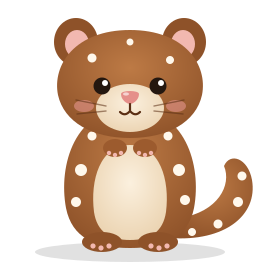

# quoll

<p align="center"></p>

A terminal viewer for a story's design notebook: a folder of markdown pages and images, readable in Obsidian too.

```
quoll [dir] [--focus[=name]] [--no-follow]  view the notebook
quoll show <page>[#heading]                 make the open viewers show a page
quoll path                                  print the notebook folder
quoll watch                                 print "changed: <page>" each time a page is saved
```

Set `QUOLL_DIR` to the notebook root, which holds a folder per notebook. `quoll` browses them all; `quoll --focus=sc-123` opens `$QUOLL_DIR/sc-123`, creating it when it's missing; and a bare `--focus` names the notebook after the current directory, so from `~/work/stories/sc-123` it opens `$QUOLL_DIR/sc-123`. `--dir` overrides `QUOLL_DIR` for one run. Without it, the notebook root is the current directory, and `--focus` needs a name. A folder named on the command line is opened as it is.

Inside qmux, `quoll show`, `quoll path` and `quoll watch` use the notebook the quoll in the same tab is showing, so they work from anywhere in the tab.

Keys: `j`/`k`, `d`/`u`, `g`/`G` scroll · `f` links · `p` pages · `o` outline · `i` index · `H`/`L` back and forward · `e` edit in helix · `w` follow · `r` reload · `q` quit.


Follow mode jumps to whatever page in the notebook changed last, at the changed line. Scrolling, navigating, or `quoll show` turns it off; `w` turns it back on.

`quoll show` reaches every viewer on the notebook. Inside qmux it reaches only the viewers in the same tab, which find each other through `QMUX_TAB_DIR`.

Images show through kitty graphics, inside qmux too. ` ```mermaid ` blocks are drawn as images by mermaid's command-line tool, which drives the installed Chrome or Chromium (`QUOLL_CHROME` picks another). Drawings are kept in `$XDG_STATE_HOME/quoll/mermaid`, so a diagram is drawn once and again only when it changes. While one draws, and wherever images can't show, the block shows its source; a diagram that fails to draw shows its source and mermaid's error.
